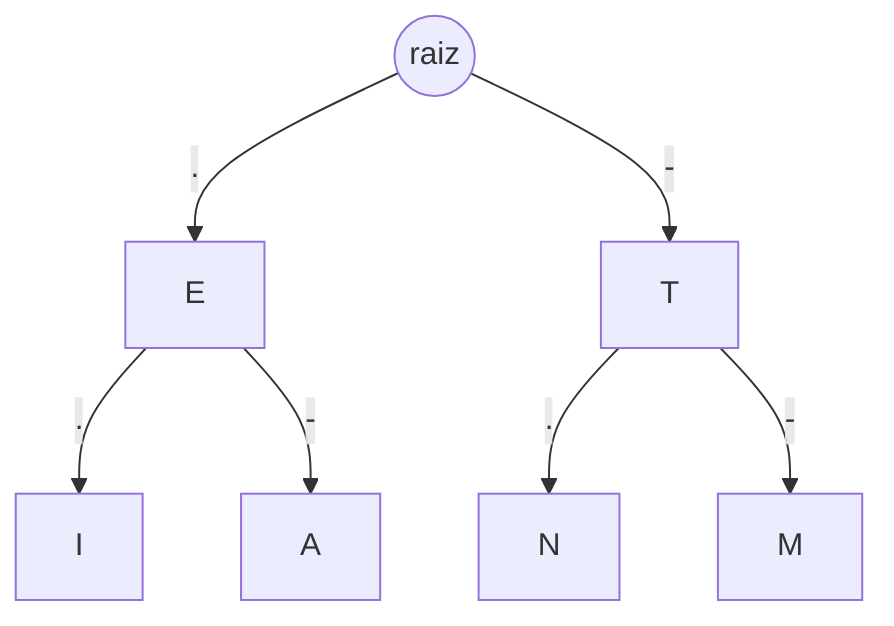

<div align="center">

# 📡 Código Morse com Árvore Binária de Busca

### TDE 2 · Listas Não-Lineares: Código Morse


</div>

---

> [!IMPORTANT]
> 📅 **Data de entrega: 06/11/2026 (sexta-feira)**
> Entrega pelo link do repositório no GitHub (público) ou pelo projeto compactado no Canvas.
> A **prova de autoria** acontece na data do cronograma da disciplina, e quem faltar fica com **nota 0**.

---

## 📑 Índice

- [📋 Ficha do projeto](#-ficha-do-projeto)
- [💡 Sobre o projeto](#-sobre-o-projeto)
- [👥 Integrantes](#-integrantes)
- [🎯 O que o trabalho precisa entregar](#-o-que-o-trabalho-precisa-entregar)
- [🚀 Como rodar na sua máquina](#-como-rodar-na-sua-máquina)
- [🗂️ Estrutura do projeto](#️-estrutura-do-projeto)
- [🧩 Divisão de tarefas](#-divisão-de-tarefas)
- [🔀 Fluxo de trabalho com Git](#-fluxo-de-trabalho-com-git-pelo-intellij)
- [✍️ Padrão de código](#️-padrão-de-código)
- [🎓 Prova de autoria](#-prova-de-autoria)
- [✅ Checklist de entrega](#-checklist-de-entrega)
- [🏷️ Tags](#️-tags)
- [🙌 Créditos](#-créditos)

---

## 📋 Ficha do projeto

| | |
|---|---|
| 🏫 **Instituição** | PUCPR – Grupo Marista |
| 🎓 **Curso** | Bacharelado em Engenharia de Software |
| 📚 **Disciplina** | Resolução de Problemas Estruturados em Computação |
| 👩‍🏫 **Professora** | Lisiane Reips |
| 👥 **Grupo** | 4 integrantes (confirmado com a professora) |
| 📅 **Entrega** | **06/11/2026** |
| 🛠️ **Tecnologias** | Java 24 · JavaFX · Maven · JUnit 5 |

---

## 💡 Sobre o projeto

O programa armazena o alfabeto Morse em uma **árvore binária de busca**:

> **ponto (`.`) vai para a esquerda** · **traço (`-`) vai para a direita**

A partir dela, o programa:

- 🔤 **codifica** texto em Morse
- 🔡 **decodifica** Morse em texto
- 🌳 **desenha** a árvore na tela
- 🔊 **toca o som** dos sinais (ponto extra)

### Exemplo: os primeiros níveis da árvore



Para chegar ao **A** (`.-`): raiz → esquerda (`.`) → direita (`-`).

---

## 👥 Integrantes

| # | Nome | Usuário no GitHub | Parte |
|---|------|-------------------|-------|
| 1 | Gabriela | _preencher_ | 🌱 Núcleo da árvore |
| 2 | Isabelle | _preencher_ | 🔁 Codificar e decodificar |
| 3 | Pedro | _preencher_ | 🖥️ Interface JavaFX |
| 4 | Laura | _preencher_ | 🔊 Som e testes |

---

## 🎯 O que o trabalho precisa entregar

| Requisito | Pontos |
|-----------|:------:|
| Inserção dos caracteres conforme a heurística do Morse (ponto à esquerda, traço à direita) | **3** |
| Decodificar uma sequência fornecida pelo usuário e mostrar o resultado | **2** |
| Codificar/decodificar (o item aparece repetido no PDF; implementamos os dois sentidos) | **2** |
| Imprimir a árvore de forma clara (código base já fornecido) | **1,5** |
| Código modularizado em classes e funções, nomes claros, camelCase | **1,5** |
| ⭐ **Extra:** som | **+1** |

> [!WARNING]
> **Prova de autoria:** todos do grupo precisam saber explicar o código inteiro. Veja a seção [Prova de autoria](#-prova-de-autoria).

---

## 🚀 Como rodar na sua máquina

### 📦 O que instalar

- ☕ **JDK 24** (a versão está no `pom.xml`, na propriedade `maven.compiler.release`)
- 💻 **IntelliJ IDEA** (a Community serve)
- 🔧 **Git**
- 🐙 Conta no **GitHub**, com o convite de colaborador aceito

> [!NOTE]
> Não precisa instalar o JavaFX: o Maven baixa sozinho.

### 🪜 Passo a passo (IntelliJ)

1. Abra o IntelliJ e vá em **File → New → Project from Version Control** (ou **Get from VCS**, na tela inicial).
2. Escolha **Git**, cole a URL do repositório e clique em **Clone**.
3. Se perguntar, clique em **Trust Project**.
4. Espere o Maven importar as dependências (barra de progresso no canto inferior). Se aparecer o ícone do **"m" com setinha** no editor, clique nele.
5. Vá em **File → Project Structure → Project** e confira se o **SDK** e o **Language level** estão em **24**.
6. Abra `src/main/java/br/pucpr/codigomorse/TreeVisualizer.java`, clique com o botão direito e escolha **Run 'TreeVisualizer.main()'**.
7. Deve abrir uma janela com a árvore. Se abriu, está tudo certo! 🎉

### ⌨️ Alternativa pelo terminal

Na pasta do projeto:

```
mvnw.cmd javafx:run      (Windows)
./mvnw javafx:run        (Linux/macOS)
```

### 🛠️ Problemas comuns

| Mensagem | Causa e solução |
|----------|-----------------|
| `modules are not supported in -source 8` | O `pom.xml` está compilando em Java 8. Confira se **não existe** `<source>8</source>`/`<target>8</target>` no `maven-compiler-plugin` e se `maven.compiler.release` está em 24. Depois recarregue o Maven. |
| `cannot find symbol` / pacote `javafx` não encontrado | O Maven ainda não importou. Clique no "m" com setinha ou *botão direito no `pom.xml` → Maven → Reload project*. |
| `JavaFX runtime components are missing` | Rode pelo IntelliJ (Run) ou por `mvnw javafx:run`, não pelo `java` direto. Confira se o `module-info.java` existe. |
| SDK diferente do `pom.xml` | Ajuste em **File → Project Structure → Project → SDK**. |
| Push recusado | Verifique se aceitou o convite de colaborador e se está empurrando **para a sua branch**, não para a `main`. |

---

## 🗂️ Estrutura do projeto

```
src/main/java/br/pucpr/codigomorse/
├── Node.java              # nó da árvore: letter, left, right
├── MorseAlphabet.java     # tabela letra → código Morse
├── MorseBST.java          # insert, encode, decode, getHeight
├── TreeDrawer.java        # desenho da árvore no Canvas (drawTree/drawNode)
├── MorseSoundPlayer.java  # bipes curtos e longos
└── TreeVisualizer.java    # janela JavaFX (interface) e main
module-info.java           # requires javafx.controls, java.desktop
```

O código base da professora trazia `Node` e `MorseBST` dentro do `TreeVisualizer`. A **Etapa 0** (abaixo) separa tudo em arquivos para cada pessoa trabalhar sem conflito.

### 🔣 Convenção de entrada e saída

- Letras do Morse separadas por **espaço**; palavras separadas por **`/`**.
  Exemplos: `... --- ...` ou `.... . .-.. .-.. --- / .-- --- .-. .-.. -..`
- A raiz da árvore não tem letra (usamos `' '`).
- Letras maiúsculas; ignorar ou avisar sobre caracteres sem código.

### 📜 Contrato da `MorseBST`

Todos programam contra estas assinaturas, para trabalhar em paralelo:

```java
public MorseBST()
public void insert(char letter, String morseCode)
public char decodeLetter(String morseCode)     // ".-"  -> 'A'
public String encodeLetter(char letter)        // 'A'   -> ".-"
public String decodeMessage(String morse)      // ".- -..." -> "AB"
public String encodeMessage(String text)       // "AB"  -> ".- -..."
public int getHeight()
```

---

## 🧩 Divisão de tarefas

### 🏁 Etapa 0 – Esqueleto (Isabelle, antes de todos)

- [ ] Criar os arquivos da estrutura acima, mover `Node` e `MorseBST` para arquivos próprios e `drawTree`/`drawNode` para `TreeDrawer`
- [ ] Declarar os métodos do contrato (podem retornar valores provisórios)
- [ ] Conferir que o projeto compila e roda, e dar push na `main`
- [ ] Avisar o grupo. **Só depois disso os outros começam.**

### 🌱 Gabriela – Núcleo da árvore (3 pontos)

- [ ] `Node` com `letter`, `left`, `right`
- [ ] `MorseAlphabet`: A–Z (e números, se quiserem)
- [ ] `MorseBST.insert`: percorrer o código; `.` vai para a esquerda e `-` para a direita; criar os nós intermediários vazios; colocar a letra no último nó
- [ ] Preencher a árvore com o alfabeto ao iniciar o programa
- [ ] Conferir se a árvore desenhada bate com a tabela Morse

### 🔁 Isabelle – Codificar e decodificar (2 + 2 pontos)

- [ ] `decodeLetter`: seguir o caminho da raiz até o nó
- [ ] `decodeMessage`: separar letras por espaço e palavras por `/`
- [ ] `encodeLetter`: buscar a letra na árvore e montar o caminho (`.`/`-`)
- [ ] `encodeMessage`
- [ ] Tratar entrada inválida (símbolo desconhecido, caractere sem código, texto vazio)

### 🖥️ Pedro – Interface JavaFX (1,5 ponto)

- [ ] Mover o desenho para `TreeDrawer` (se ainda não estiver)
- [ ] Campo de texto para o usuário digitar
- [ ] Botões **Codificar**, **Decodificar** e **Tocar som** (ligado à parte da Laura)
- [ ] Área de resultado na tela
- [ ] Canvas da árvore dentro de um `ScrollPane` (a árvore fica larga)
- [ ] Mensagens de erro amigáveis

### 🔊 Laura – Som e testes (+1 ponto e 1,5 ponto)

- [ ] `MorseSoundPlayer` com `javax.sound.sampled`: tom de ~600 Hz, ponto curto, traço longo, pausas entre letras e palavras
- [ ] Tocar em **thread separada**, para a janela não travar
- [ ] Testes JUnit (já estão no `pom.xml`) para `insert`, `decode` e `encode`
- [ ] Revisar nomes e camelCase em todo o código

### 🔗 Ordem e dependências

```
Etapa 0 (Isabelle) ──► Gabriela (insert) ──► Isabelle (decode/encode)
        │                                              │
        ├──────────► Pedro (interface) ◄───────────────┤
        └──────────► Laura (som, testes) ◄─────────────┘
```

Enquanto o `insert` não estiver pronto, Isabelle, Pedro e Laura programam contra o contrato e testam com a árvore montada à mão.

---

## 🔀 Fluxo de trabalho com Git (pelo IntelliJ)

> [!IMPORTANT]
> **Regra de ouro:** ninguém dá push direto na `main`. Cada pessoa trabalha na sua branch e entra na `main` por Pull Request.

1. **Atualizar antes de começar:** **Git → Update Project** (ou `Ctrl+T`).
2. **Criar sua branch:** clique no nome da branch (barra de cima) → **New Branch...**. Nomes sugeridos: `feature/insert`, `feature/encode-decode`, `feature/interface`, `feature/som`.
3. **Commits pequenos e frequentes:** janela **Commit** (`Ctrl+K`), mensagem curta dizendo o que mudou.
4. **Enviar:** **Git → Push** (`Ctrl+Shift+K`).
5. **Abrir o Pull Request** no GitHub (aparece o botão *Compare & pull request*).
6. **Revisão cruzada:** outra pessoa do grupo lê e aprova antes do merge.
   Sugestão: Gabriela revisa Isabelle → Isabelle revisa Pedro → Pedro revisa Laura → Laura revisa Gabriela.
7. Depois do merge, todos fazem **Update Project** na `main` e atualizam suas branches.

> [!TIP]
> Para evitar conflitos, cada pessoa mexe, em geral, nos **arquivos da sua parte**. Se precisar alterar um arquivo de outra pessoa, avise o grupo antes.

---

## ✍️ Padrão de código

- Nomes de métodos e variáveis em **camelCase** e que expliquem o que fazem (`decodeMessage`, não `dm`)
- Classes em **PascalCase** (`MorseBST`)
- Um arquivo por classe
- Métodos curtos, com uma responsabilidade cada
- Comentários só onde ajudarem a entender o porquê

---

## 🎓 Prova de autoria

Cada integrante deve conseguir explicar, sem consultar:

- Como a árvore é montada e por que ponto vai à esquerda e traço à direita
- Como o `insert` percorre o código e cria nós intermediários
- Como `decodeLetter` e `encodeLetter` funcionam (e a diferença entre os dois)
- Como o desenho calcula a posição dos nós (`xOffset` caindo pela metade a cada nível)
- Como o som é gerado e por que roda em outra thread
- O que cada classe faz e por que foi separada

> [!TIP]
> **Antes da data da prova:** reunião em que cada pessoa explica a sua parte aos outros e responde perguntas sobre as partes dos colegas.

---

## ✅ Checklist de entrega

- [ ] Projeto compila e roda em todas as máquinas do grupo
- [ ] Inserção funcionando e árvore desenhada corretamente
- [ ] Decodificar e codificar funcionando, com entrada inválida tratada
- [ ] Som funcionando
- [ ] Código modularizado, com camelCase
- [ ] README completo, com os nomes dos integrantes
- [ ] Repositório **público**
- [ ] Link entregue no Canvas até **06/11/2026**
- [ ] Todos preparados para a prova de autoria

---

## 🏷️ Tags

`java` `javafx` `maven` `intellij-idea` `junit5` `binary-search-tree` `arvore-binaria-de-busca` `morse-code` `codigo-morse` `data-structures` `estruturas-de-dados` `listas-nao-lineares` `pucpr` `engenharia-de-software` `trabalho-academico`

---

## 🙌 Créditos

### 👥 Equipe

| | Integrante | Contribuição |
|:-:|------------|--------------|
| 🌱 | **Gabriela** | Núcleo da árvore: `Node`, alfabeto e inserção |
| 🔁 | **Isabelle** | Esqueleto do projeto, codificação e decodificação |
| 🖥️ | **Pedro** | Interface JavaFX |
| 🔊 | **Laura** | Som e testes |

### 🏫 Contexto acadêmico

- **Professora:** Lisiane Reips
- **Disciplina:** Resolução de Problemas Estruturados em Computação
- **Curso:** Bacharelado em Engenharia de Software · PUCPR – Grupo Marista

### 📚 Referências

- Código base do desenho da árvore (`TreeVisualizer.java`) fornecido pela professora Lisiane Reips
- [Documentação do JavaFX](https://openjfx.io/openjfx-docs/)

<div align="center">

Feito com ☕ e 💙 pelos alunos de Engenharia de Software da PUCPR · 2026

</div>
